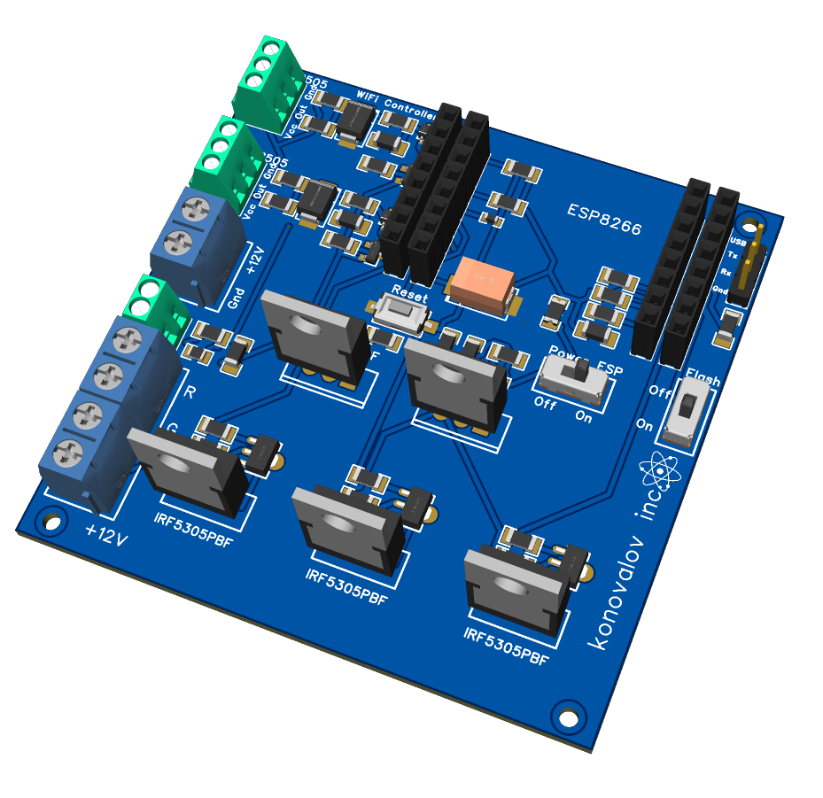
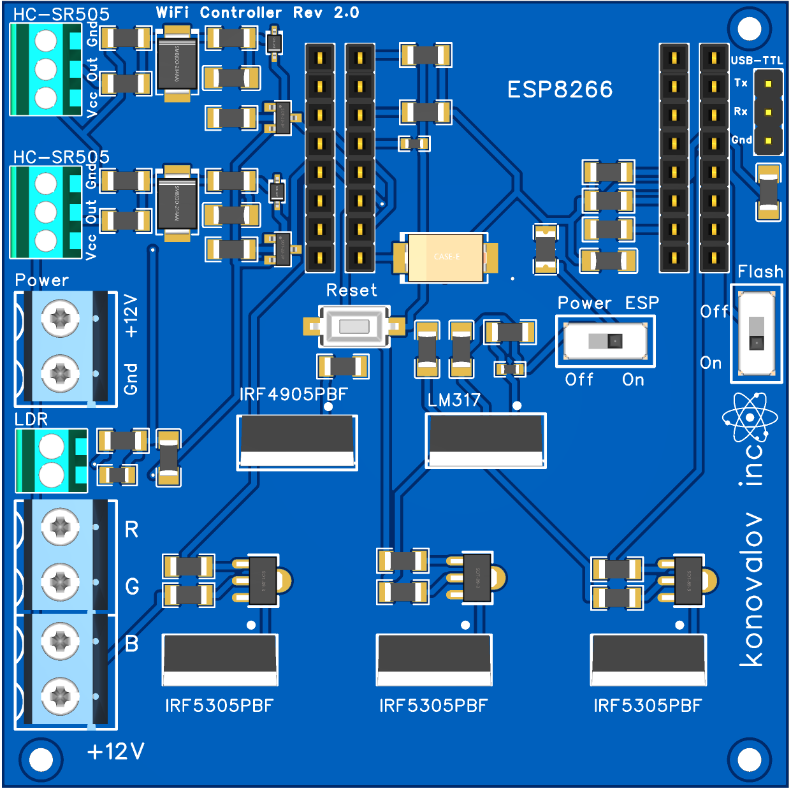

# WiFi LED Controller

Прошивка Wi-Fi RGB-контроллера на ESP8266 / ESP-07, собранная в PlatformIO.

## Возможности

- Автоматический режим: любой из двух датчиков движения включает подсветку; таймер 1–3600 секунд отсчитывается от последнего активного сигнала датчика.
- Датчик освещённости можно отключить. Порог 0–1023, текущие показания и кнопка калибровки доступны в интерфейсе.
- Пока свет включён, движение продлевает таймер независимо от освещённости: собственная подсветка не мешает датчикам.
- Ручной режим: кнопка включения/выключения сразу переводит устройство в ручной режим, в том числе из автоматического.
- RGB-цвет, яркость 0–100%, раздельное время включения и выключения 0–10 секунд.
- Переходы без `delay()`-циклов; обратное переключение во время перехода начинается с текущего уровня света.
- Поиск Wi-Fi и ручной ввод SSID, включая скрытые сети; восстановление связи и резервная точка доступа.
- Сохранение настроек в LittleFS с проверкой временного файла и резервной копией.
- OTA через веб-интерфейс и VS Code: пароль обновления, проверка размера/MD5, автоматическая перезагрузка без стирания настроек.
- Светлая, тёмная и системная темы. Выбор хранится в браузере; системная тема меняется вместе с оформлением ОС.

Кнопки режима и питания действуют сразу. Остальные параметры света применяются кнопкой **«Применить настройки»**.
Изменения записываются во Flash через 1,5 секунды после последней команды; интерфейс показывает состояние сохранения.
Перед отключением питания дождитесь надписи «Настройки сохранены». Восстанавливаются режим, параметры света, автоматики и Wi-Fi; ручное состояние питания после старта остаётся выключенным.
При настройке Wi-Fi отдельный блок показывает ход подключения, ошибку либо подтверждение сохранения с адресом устройства. При отправке фокус снимается с поля пароля, после успеха форма сворачивается. В шапке рядом со статусом связи отображается RSSI соединения контроллера с роутером в dBm.

## Аппаратная часть

Основная плата — **WiFi Controller Rev 2.0**. Она объединяет питание ESP8266, три силовых канала RGB, два входа движения, вход фоторезистора и разъём загрузки прошивки. С датчиками HC-SR505 используются отдельные инверторы сигнала **Rev 1.0**. Ревизии плат и версия прошивки ведутся независимо.

### Проект и электрические схемы

| Файл | Содержимое |
| --- | --- |
| [WiFiController.epro](easyeda/WiFiController.epro) | Полный проект EasyEDA Pro: схема основной платы `ESP8266Board`, схема `PIR sensor logical invertor`, печатная плата и используемые библиотеки |
| [main_board.pdf](docs/main_board.pdf) | Электрическая схема основной платы, Rev 2.0 |
| [pir_sensor_invertor.pdf](docs/pir_sensor_invertor.pdf) | Электрическая схема инвертора HC-SR505, Rev 1.0 |

Для редактирования импортируйте `.epro` в EasyEDA Pro. PDF предназначены для просмотра и сверки соединений. При изменении схемы обновляйте исходный проект и соответствующий PDF вместе.

### Общий вид платы



На рендере показана основная плата без установленного ESP8266. Для подключения проводов и выбора положения переключателей используйте [вид сверху](#board-top).

### Узлы основной схемы

| Узел | Элементы | Назначение |
| --- | --- | --- |
| Питание | P1, Q9 IRF4905PBF, U1 LM317, SW1, F1, C1–C4 | Вход 12 В, входной MOSFET, линейное преобразование в 3,3 В, выключатель `Power ESP`, предохранитель и фильтрация питания ESP |
| Модуль ESP8266 | H1–H4, R3–R5, R21–R23 | Контакты установки модуля и цепи задания уровней запуска, разрешения работы и сброса |
| RGB-каналы | Q1–Q3 PXT2222A, Q4–Q6 IRF5305PBF, R14–R19, P4/P5 | Три силовых канала управления подсветкой; наружные клеммы подписаны `R`, `G`, `B`, `+12V` |
| Входы движения | P2/P3, Q7/Q8 BC807, D1/D3 SM6T15A, D2/D4, R6–R13, C5/C6 | Подтяжка сигнальных линий, защита, фильтрация и инверсия сигнала для GPIO13 и GPIO5 |
| Освещённость | P6 `LDR`, R20, R24, C8 | Подключение фоторезистора, делитель и фильтр сигнала для входа A0 |
| Загрузка и перезапуск | J2 `USB-TTL`, SW2 `Flash`, KEY1 `Reset` | UART для первой прошивки и диагностики, выбор загрузчика через GPIO0 и ручной сброс ESP |

`Power ESP` отключает ветвь питания ESP после регулятора. При подключённом источнике на входе `Power` цепи 12 В остаются под напряжением; для монтажа проводов отключайте сам источник питания.

### Датчики движения и отдельный инвертор

Выход каждого HC-SR505 подключается к отдельному инвертору по [схеме Rev 1.0](docs/pir_sensor_invertor.pdf). На этой схеме P7 — подключение самого датчика, Q10 (2N4401-TA) — инвертирующий транзистор, R27/R28 — цепь базы, R26 — последовательный резистор выхода, C1/C2 — фильтрация питания. Сигнал с меткой `OUT` после Q10 подаётся на контакт `Out` разъёма P2 или P3 основной платы. Питание и земля обеих плат общие.

Таким образом, в тракте движения **две инверсии**:

| Состояние | Выход самого HC-SR505 | `OUT` инвертора / `Out` на P2/P3 | GPIO13 / GPIO5 после Q7/Q8 |
| --- | --- | --- | --- |
| Нет движения | LOW | HIGH за счёт подтяжки на основной плате | LOW |
| Есть движение | HIGH | LOW | HIGH — движение |

Поэтому `Board::MotionActiveHigh = true` относится к уровню **на GPIO ESP**, а активный сигнал на внешнем разъёме основной платы — **низкий**. Описанная конфигурация предполагает подключение HC-SR505 через инвертор.

Для проверки входа без датчика отключите его сигнальный кабель и кратковременно замкните `Out` и `Gnd` соответствующего разъёма основной платы. В интерфейсе должно появиться «Движение». Чтобы включилась подсветка, выберите автоматический режим, дождитесь окончания 30-секундного прогрева и отключите учёт освещённости либо обеспечьте темноту. После размыкания начнётся отсчёт заданного времени выключения. Не замыкайте выход подключённого датчика или инвертора; `Vcc` в этой проверке не используется.

## Распиновка

Используются номера GPIO, а не обозначения D0–D8 с плат NodeMCU.
Соответствие каналов в прошивке согласовано с добавленной [схемой основной платы](docs/main_board.pdf): R — GPIO4, G — GPIO12, B — GPIO14.

| Сигнал | ESP8266 |
| --- | --- |
| Красный, R | GPIO4 |
| Зелёный, G | GPIO12 |
| Синий, B | GPIO14 |
| Датчик движения 1 | GPIO13 |
| Датчик движения 2 | GPIO5 |
| Датчик освещённости | A0 |

Настройки платы находятся в `include/Board.h`. После внешних инверторов и входных каскадов платы движение соответствует HIGH на GPIO13/GPIO5. PWM активен высоким уровнем; диапазон PWM явно установлен в 0–1023, частота — 1 кГц.
Меньшее значение A0 соответствует темноте, как в старой прошивке. Измерение фильтруется; гистерезис выхода из темноты — 20 отсчётов (с ограничением 1023).

После подачи питания выходы выключены. Сохранённый режим восстанавливается, но ручное состояние «включено» не восстанавливается: включение выполняется новой командой.
Автоматика ждёт 30 секунд прогрева PIR; ручное управление доступно сразу. Фактическая задержка выключения включает собственную длительность высокого сигнала HC-SR505, заданный таймер и плавное затухание.

## Подключение платы

### Вид сверху и расположение разъёмов

<a id="board-top"></a>



Все указания «сверху», «снизу», «слева» и «справа» в инструкциях относятся к этому изображению: надпись `WiFi Controller Rev 2.0` находится сверху, клеммы — слева, `USB-TTL` и `Flash` — справа. Ориентируйтесь также на маркировку своей платы.

| Обозначение | Положение на виде сверху | Подключение или действие |
| --- | --- | --- |
| `Power` (P1) | Слева, под двумя разъёмами датчиков | Сверху `+12V`, снизу `Gnd`: питание от источника 12 В |
| Верхний `HC-SR505` (P2) | В левом верхнем углу | Сверху вниз: `Gnd`, `Out`, `Vcc`; датчик 1 через инвертор, сигнал приходит на GPIO13 |
| Нижний `HC-SR505` (P3) | Слева, между P2 и `Power` | Сверху вниз: `Gnd`, `Out`, `Vcc`; датчик 2 через инвертор, сигнал приходит на GPIO5 |
| `LDR` (P6) | Слева, под `Power` | Два вывода фоторезистора; сам фоторезистор неполярный |
| Выход RGB (P5/P4) | Четыре винтовых контакта слева внизу | Сверху вниз: `R`, `G`, `B`, `+12V` |
| `USB-TTL` (J2) | У правого верхнего угла | Сверху вниз: `Tx`, `Rx`, `Gnd`; UART с уровнями 3,3 В |
| `Power ESP` (SW1) | Справа от центра | `Off` слева, `On` справа: выключение и включение питания ESP |
| `Flash` (SW2) | Справа у края, вертикальный переключатель | `Off` сверху — обычный запуск; `On` снизу — загрузчик после сброса |
| `Reset` (KEY1) | Около центра, слева от `Power ESP` | Краткое нажатие перезапускает ESP с выбранным положением `Flash` |

### Подключение подсветки и датчиков

1. Отключите источник 12 В. Установите ESP-07 в соответствующее посадочное место, сверив ориентацию выводов со схемой.
2. Подключите выводы аналоговой RGB-подсветки 12 В к одноимённым клеммам `R`, `G`, `B`, `+12V` слева внизу.
3. Подключите датчики через инверторы: `Gnd` — общая земля, `Vcc` — питание 12 В, `Out` — выход инвертора. Порядок контактов обоих разъёмов основной платы на виде сверху: **Gnd → Out → Vcc**. На отдельной плате датчика сверяйте назначения выводов, а не только их расположение.
4. Подключите фоторезистор к двум контактам `LDR`, если требуется учёт освещённости.
5. Подключите источник к `Power`: верхний контакт — `+12V`, нижний — `Gnd`. Для обычной работы установите `Flash = Off`, `Power ESP = On` и включите источник питания.

Для первой загрузки прошивки достаточно основной платы с ESP-07, питания и USB–UART. Последовательность входа в загрузчик приведена ниже.

## Сборка

Используется профиль ESP-07 с 1 МБ Flash и 64 КБ LittleFS. Профиль соответствует [документации PlatformIO](https://docs.platformio.org/en/latest/boards/espressif8266/esp07.html).
Для ESP-07S или модуля с другой Flash сначала уточните объём памяти и измените профиль/разметку.

```powershell
pio run -e esp07
```

Если `pio` отсутствует в PATH, уже установленный на этом компьютере PlatformIO доступен так:

```powershell
& "$env:USERPROFILE/.platformio/penv/Scripts/platformio.exe" run -e esp07
```

Зафиксированные зависимости:

| Компонент | Версия |
| --- | --- |
| PlatformIO Espressif8266 | 4.2.1 |
| ESP8266 Arduino Core | 3.1.2 (из платформы) |
| ArduinoJson | 6.21.5 |

Wi-Fi, HTTP-сервер, DNS, mDNS и LittleFS входят в Arduino Core. Зависимости устанавливаются автоматически при сборке; в текущем окружении они уже установлены.
Версия PlatformIO Core, использованная для проверки: 6.1.12.

Результат: `.pio/build/esp07/firmware.bin`.
Веб-файлы автоматически сжимаются gzip и встраиваются в PROGMEM при сборке. **`uploadfs` выполнять не нужно**: файловая система используется только для настроек.

## Прошивка через USB–UART

Инструкция для платы **WiFi Controller Rev 2.0** с установленным ESP-07. Используйте [вид платы сверху и таблицу разъёмов](#board-top): `USB-TTL` находится вверху справа, `Power` — слева, `Power ESP` — справа от центра, `Flash` — у правого края, `Reset` — около центра.

### 1. Подключение

При отключённом питании платы подключите адаптер по таблице. На [виде сверху](#board-top) контакты `USB-TTL` расположены сверху вниз: **Tx → Rx → Gnd**.

| USB–UART адаптер | Разъём `USB-TTL` платы |
| --- | --- |
| `TXD` / `TX` | `Rx` |
| `RXD` / `RX` | `Tx` |
| `GND` | `Gnd` |

Используйте UART с уровнями **3,3 В**, не 5 В и не RS-232. На некоторых адаптерах перемычка 3,3/5 В меняет только выход питания, поэтому уровни TX/RX нужно проверить по документации адаптера. Перекрёстное подключение TX/RX и требуемое напряжение описаны в [документации Espressif](https://docs.espressif.com/projects/esptool/en/latest/esp8266/esptool/serial-connection.html).

Пины `5V`, `3V3` и `VCC` адаптера к плате **не подключайте**: плата питается через входную клемму `Power` от штатного источника 12 В. Общая земля платы и адаптера обязательна. Для загрузки датчики и RGB-лента не требуются.

### 2. Определение COM-порта

Подключите адаптер к USB компьютера. В PowerShell выполните:

```powershell
Set-Location 'C:\work\Arduino_projects\wifi-led-controller'
$pioExe = "$env:USERPROFILE\.platformio\penv\Scripts\platformio.exe"
& $pioExe device list
```

Появится список доступных COM портов. Требуемый порт будет иметь подпись **USB-SERIAL CH340 (COM4)**, где **COM4** - номер порта.
Закройте Serial Monitor, терминалы и другие программы, которые могут занимать выбранный порт.

### 3. Вход в загрузчик

1. Поставьте `Power ESP` в **Off** — влево на [виде сверху](#board-top).
2. Подайте 12 В на вход `Power`: плюс к `+12V`, минус к `Gnd`.
3. Поставьте `Flash` в **On** — вниз на виде сверху.
4. Поставьте `Power ESP` в **On** — вправо на виде сверху.
5. Кратко нажмите и отпустите `Reset`.

`Flash` оставьте в **On** до завершения записи. В этом положении GPIO0 при сбросе должен быть замкнут на землю: так ESP8266 входит в UART-загрузчик. См. [порядок выбора режима загрузки Espressif](https://docs.espressif.com/projects/esptool/en/latest/esp8266/advanced-topics/boot-mode-selection.html).

### 4. Загрузка

В том же окне PowerShell выполните (при необходимости замените COM4):

```powershell
& $pioExe run -e esp07 -t upload --upload-port COM4
```

PlatformIO соберёт проект и запишет `.pio/build/esp07/firmware.bin`. Скорость загрузки в проекте — 115200 бод.
Дождитесь завершения записи, проверки данных и результата **`SUCCESS`**. Во время записи питание не отключайте.
Интерфейс уже включён в прошивку; отдельный `uploadfs` не требуется.

### 5. Запуск прошивки

1. После `SUCCESS` переведите `Flash` в **Off** — вверх на [виде сверху](#board-top).
2. Кратко нажмите `Reset`. Вместо него можно выключить и снова включить `Power ESP`.
3. Оставьте `Power ESP` в **On**.

Через трёхпроводный разъём TX/RX/GND автоматическое управление Reset/Flash не подключено. Поэтому даже после сообщения `Hard resetting via RTS pin` нужен ручной перезапуск.
Если оставить `Flash` в On, после сброса снова запустится загрузчик, а не прошивка.

На первом запуске появится сеть `PhysTechLab-XXXXXX`, пароль — `wifi-led-controller`. Откройте `http://192.168.4.1` и настройте домашнюю сеть. Если устройство уже имеет сохранённую сеть, резервная точка доступа появляется только при неудачном подключении, примерно через 25 секунд.

Для просмотра сообщений:

```powershell
& $pioExe device monitor --port COM4 --baud 115200
```

Открыв монитор, нажмите Reset при `Flash = Off`. Для выхода из монитора — `Ctrl+C`. При следующей загрузке монитор должен быть закрыт.

### Если загрузка не начинается

- **`Failed to connect` / `Timed out waiting for packet header`:** проверьте `Power ESP = On`, `Flash = On`, общую землю и перекрёстное соединение TX/RX. Повторите команду и кратко нажмите Reset, когда появится `Connecting…`.
- **Порт занят / `Access is denied`:** закройте Serial Monitor, Arduino IDE и другие терминалы; снова проверьте номер порта.
- **`Cannot configure port`, ошибка Windows 31:** сбой возникает при настройке COM-порта до связи с загрузчиком ESP. Переподключите USB–TTL, проверьте другой USB-порт и отсутствие открытого монитора. Для некоторых CH340 новые драйверы несовместимы с адаптером; порядок установки предыдущего драйвера описан в [инструкции Arduino](https://support.arduino.cc/hc/en-us/articles/13148652511260-avrdude-ser-open-can-t-set-com-state-for-COMn). Альтернатива — исправный USB–TTL адаптер с уровнями 3,3 В. Переключение Flash само по себе ошибку настройки COM-порта не исправляет.
- **После `SUCCESS` нет запуска:** переведите Flash в Off и нажмите Reset. Сверьте сообщения Serial на скорости 115200. Короткие нечитаемые символы непосредственно при Reset могут быть ROM-сообщением на скорости 74880.

Первый запуск новой прошивки не переносит старые EEPROM/SPIFFS-настройки. Раздел LittleFS может быть отформатирован автоматически при невозможности монтирования.
Если нужно сохранить возможность точного отката, снимите резервную копию Flash до загрузки. Сам проект старой прошивки не изменялся.

## Обновление прошивки по Wi-Fi (OTA)

OTA доступно начиная с **1.1.0**. Первую версию с OTA нужно записать через USB–TTL по инструкции выше, затем поставить `Flash = Off` и нажать `Reset`. Все последующие OTA-загрузки выполняются при `Flash = Off`, без ручного переключения в загрузчик. Это соответствует [порядку первой установки ESP8266 OTA](https://arduino-esp8266.readthedocs.io/en/3.1.2/ota_updates/readme.html).

Компьютер или телефон должен находиться в одной локальной сети с контроллером. Также можно подключиться непосредственно к `PhysTechLab-XXXXXX` и открыть `http://192.168.4.1`. Дождитесь завершения подключения/поиска Wi-Fi и сохранения настроек.

### Через браузер

1. Соберите проект командой `pio run -e esp07` или возьмите готовый **`firmware.bin` именно для WiFiLedController / ESP-07 / 1 МБ / 64 КБ LittleFS**. Файл сборки находится в `.pio/build/esp07/firmware.bin`.
2. Откройте адрес контроллера → раздел **«Прошивка» → «Обновление прошивки»**. Здесь показаны текущая версия и максимально допустимый размер файла.
3. Если параметры света редактировались, сначала нажмите **«Применить настройки»**. Выберите `.bin`, введите пароль обновления и нажмите **«Загрузить прошивку»**.
4. Пароль обновления по умолчанию — **`wifi-led-controller`**. Он задан отдельно в `include/FirmwareInfo.h` (`Firmware::OtaPassword`); его можно изменить перед сборкой. Это пароль OTA, а не пароль домашнего Wi-Fi. При смене пароля в новой прошивке для её загрузки вводят ещё старый пароль; новый действует после перезапуска.
5. Дождитесь загрузки, проверки и перезапуска. Подсветка на время записи выключается. Не отключайте питание. После восстановления связи страница обновится; проверьте номер версии.

Настройки света и Wi-Fi сохраняются в LittleFS; OTA записывает только программу. `uploadfs`, образ файловой системы, `.elf`, `.hex` и `.bin.gz` здесь не используются. Восстановление ручного состояния «включено» после перезапуска не производится — как и при обычном включении питания.

При неверном пароле, повреждении/неполной передаче или слишком большом файле обновление отклоняется. Размер и MD5 проверяются до принятия образа; MD5 контролирует целостность передачи, а не подлинность прошивки. Используйте свои сборки и доверенную локальную сеть: HTTP не шифрует пароль или файл. Не публикуйте порт контроллера в интернете.

Если соединение прервалось, **не отправляйте файл сразу повторно**: контроллер мог уже принять его и перезапуститься. Подождите около минуты, восстановите подключение и нажмите **«Проверить контроллер»**. Автоматической повторной отправки нет. Если устройство не запускается после обновления, восстановите прошивку через USB–TTL.

Память ESP-07 должна одновременно вместить текущую и новую прошивки. Сборка проверяет запас для следующей OTA-загрузки (`scripts/check_ota_size.py`); фактический лимит также проверяет само устройство. Если новая версия не помещается, уменьшите образ либо обновите через USB–TTL, предварительно проверив соответствие разметки памяти плате.

### Из командной строки

В проекте есть HTTP-загрузчик без сторонних Python-зависимостей. Он использует тот же OTA API, что и браузер:

```powershell
python scripts/upload_ota.py --host 192.168.4.1 --file .pio/build/esp07/firmware.bin
```

В домашней сети замените `192.168.4.1` на IP контроллера (или его `wifi-led-controller-xxxxxx.local`, если ОС разрешает mDNS). По умолчанию используется пароль `wifi-led-controller`. Для изменённого пароля задайте переменную окружения `WIFI_LED_OTA_PASSWORD` в текущем терминале; скрипт не печатает её значение. После принятия файла скрипт ждёт появления устройства и выводит версию. Сообщение о неизвестном результате или отсутствии связи после записи требует проверки устройства, а не немедленного повтора команды.

## Загрузка из VS Code

Откройте **папку проекта целиком** (`C:\work\Arduino_projects\wifi-led-controller`) через **File → Open Folder**. Установите расширение **PlatformIO IDE** из рекомендаций проекта и дождитесь его инициализации. В репозитории добавлены задачи `.vscode/tasks.json` для Windows с обычным расположением PlatformIO (`%USERPROFILE%/.platformio/penv/Scripts/platformio.exe`). Если PlatformIO установлен иначе, исправьте путь `command` в задачах.

### Через USB–TTL

1. Подключите адаптер и питание по разделу **«Прошивка через USB–UART»**: TX/RX перекрёстно, общая GND, логические уровни **3,3 В**. Закройте Serial Monitor, чтобы освободить COM-порт.
2. На плате установите `Power ESP = On`, `Flash = On` и кратко нажмите `Reset`.
3. В VS Code выполните **Terminal → Run Task → Firmware: Upload USB-TTL**. Введите COM-порт адаптера (сейчас пример — `COM4`). Задача сама соберёт и запишет прошивку.
4. Дождитесь **`SUCCESS`**, переведите `Flash = Off` и нажмите `Reset`. Через трёхпроводное соединение автоматический сброс не работает.
5. Для сообщений устройства откройте **PlatformIO → Project Tasks → esp07 → General → Monitor** (115200 бод). Перед следующей загрузкой закройте монитор.

Альтернатива — **PlatformIO → Project Tasks → esp07 → General → Upload**. Если адаптеров несколько, укажите `upload_port = COM4` в `[env:esp07]` или используйте команду в терминале PlatformIO:

```powershell
pio run -e esp07 -t upload --upload-port COM4
```

### По Wi-Fi

1. Убедитесь, что на плате уже работает версия с OTA, `Flash = Off`, а компьютер видит веб-интерфейс контроллера.
2. Выполните **Terminal → Run Task → Firmware: Upload Wi-Fi OTA**.
3. Введите IP/имя контроллера и пароль обновления. Пароль вводится скрыто и передаётся через окружение процесса, а не аргументы командной строки.
4. Задача соберёт профиль `esp07_ota`, загрузит `.pio/build/esp07_ota/firmware.bin` и проверит возврат контроллера после перезагрузки.

Альтернативно откройте **PlatformIO → Project Tasks → esp07_ota → General → Upload**. В `[env:esp07_ota]` параметр `upload_port` задаёт адрес устройства; по умолчанию это `192.168.4.1`. Для нестандартного пароля задайте `WIFI_LED_OTA_PASSWORD` в окружении VS Code/терминала либо воспользуйтесь готовой задачей с запросом пароля.

```powershell
pio run -e esp07_ota -t upload --upload-port 192.168.4.1
```

Оба профиля собирают одну и ту же программу; отличается способ загрузки. Профиль `esp07_ota` использует [custom upload_command PlatformIO](https://docs.platformio.org/en/latest/projectconf/sections/env/options/upload/upload_command.html) и `scripts/upload_ota.py` по HTTP (порт 80). Протокол ArduinoOTA/`espota` и порт 8266 здесь не используются. Для обычной сборки без загрузки доступна задача **Firmware: Build** (`Ctrl+Shift+B`).

## Первое подключение и перенос в другую сеть

1. При отсутствии сохранённой сети контроллер сразу создаёт **`PhysTechLab-XXXXXX`**, где суффикс — идентификатор ESP. При недоступности настроенной сети — примерно через 25 секунд.
2. Подключитесь к этой сети. Пароль точки доступа: **`wifi-led-controller`**.
3. Откройте **[http://192.168.4.1](http://192.168.4.1)**. На некоторых телефонах страница откроется автоматически. Если телефон сообщает «без интернета», сохраните подключение к этой сети; при необходимости отключите мобильные данные на время настройки.
4. В разделе «Подключение Wi-Fi» найдите сеть **2,4 ГГц**, выберите её и введите пароль. Можно ввести SSID вручную. Для открытой сети пароль оставляют пустым.
5. Нажмите «Подключиться». Проверка занимает до 25 секунд. Смена радиоканала при подключении может потребовать повторного подключения телефона к точке доступа.
6. После успеха интерфейс покажет IP контроллера в домашней сети. Переключите телефон/ПК в эту сеть и откройте показанный адрес. Точка доступа выключится через 60 секунд после соединения.

Новые реквизиты записываются только после успешного подключения. При ошибке прежние сохраняются, точка доступа остаётся доступна, а контроллер продолжает попытки подключения к прежней сети.
После потери связи повторное подключение выполняется без перезапуска контроллера; через 25 секунд включается точка доступа. Работа подсветки от Wi-Fi не зависит.
Можно вообще не подключать контроллер к роутеру и пользоваться интерфейсом непосредственно через его точку доступа.

В локальной сети также объявляется имя `wifi-led-controller-xxxxxx.local` (точное имя видно в Serial). Поддержка `.local` зависит от ОС; IP-адрес остаётся основным способом доступа.

Интерфейс рассчитан на доверенную локальную сеть: отдельного пароля веб-управления и HTTPS нет. Пароль Wi-Fi не возвращается через API и не печатается в Serial, но хранится во Flash. Пароль резервной точки доступа задан в `src/NetworkManager.cpp`. OTA защищено отдельным паролем обновления; используется тот же локальный HTTP-сервер. FTP не включён.

## Установка как веб-приложение

В интерфейс включены Web App Manifest, иконки 192/512 px, maskable-иконка, Apple Touch Icon и режим `standalone`.
Внизу страницы есть кнопка «Добавить на экран»; если браузер разрешает программную установку, она меняется на «Установить приложение».

- **iPhone/iPad:** откройте постоянный адрес контроллера в Safari → «Поделиться» → «На экран Домой». Если доступен переключатель «Открывать как веб-приложение», включите его.
- **Android:** меню браузера → «Добавить на главный экран» / «Установить приложение». При прямом HTTP-доступе браузер может создать обычный ярлык.
- **ПК:** используйте пункт установки приложения в Chrome/Edge, если он доступен, либо ярлык страницы.

Для полноценной установки PWA по манифесту и работы Service Worker браузерам нужен доверенный HTTPS (исключение — `localhost` / `127.0.0.1` при разработке). Локальные `http://192.168…` и `http://…local` таким контекстом не являются. Это [ограничение браузеров](https://developer.mozilla.org/en-US/docs/Web/Progressive_web_apps/Guides/Making_PWAs_installable), а не прошивки; доступность отдельного окна при добавлении обычного HTTP-сайта зависит от браузера.

При открытии через доверенный HTTPS-прокси Service Worker включается автоматически и сохраняет только оболочку интерфейса. Прокси должен направлять `/`, статические файлы и `/api/` на один контроллер, сохраняя внешний заголовок `Host` (включая порт, если он есть). Настройка HTTPS-прокси не требуется для обычной работы и в проект не включена.
Офлайн-оболочка показывает отсутствие связи и блокирует управление. Команды, состояния датчиков и пароли **никогда не кэшируются** и не отправляются позже автоматически.

Установленное приложение привязано к адресу контроллера. Добавляйте его после настройки домашней сети; для стабильного адреса можно закрепить DHCP-адрес на роутере. Ярлык `192.168.4.1` работает только при подключении к резервной точке доступа.

## Структура

```text
easyeda/WiFiController.epro   Исходный проект схем и печатной платы EasyEDA Pro
docs/main_board.pdf         Электрическая схема основной платы Rev 2.0
docs/pir_sensor_invertor.pdf Электрическая схема инвертора датчика Rev 1.0
docs/images/                Общий вид платы и вид сверху для инструкций
include/Board.h              GPIO и параметры платы
include/LightController.h    Независимая от Arduino логика света и переходов
src/Configuration.cpp       Проверка настроек и сохранение LittleFS
src/NetworkManager.cpp      Wi-Fi, DNS captive portal, mDNS, резервная AP
src/main.cpp                Инициализация, датчики, PWM, HTTP API
src/OtaManager.cpp          HTTP OTA, пароль, потоковая запись и перезапуск
include/FirmwareInfo.h      Версия и пароль обновления
include/FirmwareUpload.h    Проверки и безопасное прерывание OTA
web/                        HTML, CSS, JavaScript интерфейса
scripts/embed_web.py         Встраивание интерфейса при сборке
scripts/test_native.py       Запуск тестов C++ на компьютере
scripts/upload_ota.py        Загрузка по Wi-Fi из терминала и VS Code
scripts/check_ota_size.py    Проверка запаса Flash для следующего OTA
tests/                      Тесты автоматики, сети и интерфейса
```

## HTTP API

Команды управления используют POST с `Content-Type: application/json`; неверные типы, диапазоны и неизвестные поля настроек отклоняются. Origin браузерного запроса должен совпадать с адресом контроллера.

| Метод и путь | Назначение |
| --- | --- |
| `GET /api/ota` | Версия, предельный размер образа и статус OTA |
| `POST /api/ota` | Один multipart-файл `firmware`; заголовки `X-OTA-Password`, `X-Firmware-Size`, `X-Firmware-MD5`; при успехе 202 и перезапуск |
| `GET /api/state` | Настройки, состояние света, датчики, сеть и статус сохранения |
| `POST /api/settings` | Частичное изменение параметров света |
| `POST /api/power` | `{"on":true}` / `{"on":false}`; всегда включает ручной режим |
| `POST /api/wifi` | `{"ssid":"MyWiFi","password":"example-password"}`; пробное подключение |
| `POST /api/wifi/scan` | `{}`; начать асинхронный поиск сетей |
| `GET /api/wifi/scan` | Состояние поиска и до 20 уникальных SSID |

Пример настроек:

```json
{
  "mode": "auto",
  "useLightSensor": true,
  "holdSeconds": 30,
  "darkThreshold": 50,
  "brightness": 70,
  "color": "#ffb464",
  "fadeInMs": 700,
  "fadeOutMs": 1200
}
```

## Проверки

Тесты логики C++ (требуется `g++` в PATH, в этом окружении доступен MSYS2):

```powershell
python scripts/test_native.py
```

OTA-тест проверяет получение файла по частям, отмену после передачи полного содержимого до конца HTTP-запроса, обрыв, неверную сигнатуру, размер, ошибку записи/MD5 и повторную попытку без перезагрузки.
Проверяются таймер движения, ручной приоритет, освещённость, прогрев датчиков, нулевая яркость, цвет, прерывание переходов и переполнение `millis()`.
Тест конфигурации использует настоящий `Configuration.cpp` и ArduinoJson с имитацией LittleFS: сохранение всех параметров, загрузка новым экземпляром хранилища, ошибка записи и восстановление резервной копии.
Сетевые тесты компилируют настоящий `NetworkManager.cpp` с имитацией Wi-Fi: первый запуск, успешная настройка, неверный пароль, сохранение прежней сети, отключение AP и восстановление связи. Это не проверка радиомодуля на реальной плате.

Браузерные тесты (Node.js 18+, Playwright):

```powershell
npm ci
npx playwright install chromium webkit
npm test
```

На этом компьютере системный Node.js 16 устарел; проверки запускались поставляемым Node.js 24:

```powershell
& "$env:USERPROFILE/.cache/codex-runtimes/codex-primary-runtime/dependencies/node/bin/node.exe" node_modules/playwright/cli.js test
```

Браузерные тесты используют имитированный HTTP API, проверяют настольный и мобильный размеры, ручное управление, применение настроек, поиск Wi-Fi и восстановление после потери связи. Скриншоты сохраняются в `test-results/`.
Отдельные проверки PWA на localhost проверяют манифест, установку Service Worker, открытие оболочки без сети и запрет кэширования/отложенного выполнения команд.
`npm run preview` запускает только статическую страницу; без устройства или тестового API она покажет отсутствие связи.

Перед эксплуатацией на плате остаётся проверить реальные R/G/B-каналы, полярность датчиков, диапазон A0 и порог темноты, работу после отключения роутера, ввод неверного пароля и сохранение после снятия питания. Автоматические проверки не заменяют эти аппаратные испытания.

Тесты HTTP-загрузчика на локальном имитаторе устройства (без записи на плату):

```powershell
python -m unittest discover -s tests -p "test_*.py" -v
```

Проверяются заголовки, размер/MD5, отказ при неверном файле/пароле и отсутствие повторной отправки при обрыве. Браузерные OTA-тесты дополнительно проверяют прогресс, блокировку управления во время записи и возврат после перезагрузки.


## Система (с версии 1.2.0)

В разделе «Система» доступны перезагрузка и полный сброс настроек. Каждое действие требует подтверждения в интерфейсе.

- **Перезагрузить:** сохраняет применённые настройки во Flash перед перезапуском. Подсветка запускается выключенной; автоматический режим возобновляется после прогрева датчиков.
- **Сбросить все настройки:** форматирует раздел LittleFS (включая резервные и временные настройки), очищает конфигурацию Wi-Fi SDK и перезапускает устройство. Прошивка остаётся установленной. Подключитесь к `PhysTechLab-XXXXXX`, пароль `wifi-led-controller`, адрес `http://192.168.4.1`.

Неприменённые изменения формы при подтверждении теряются. При обрыве связи команда не повторяется автоматически. POST `/api/system/reboot` и `/api/system/reset` принимают JSON `{"confirm":true}`; во время OTA или подключения/поиска Wi-Fi действия заблокированы.

На телефоне касание вне текстового поля закрывает клавиатуру. Клавиша «Далее» в SSID переводит к паролю; «Готово» в пароле только закрывает клавиатуру. Подключение запускается кнопкой «Подключиться». Периодический опрос не переоткрывает свёрнутую форму и не перезаписывает её неизменившиеся элементы.
